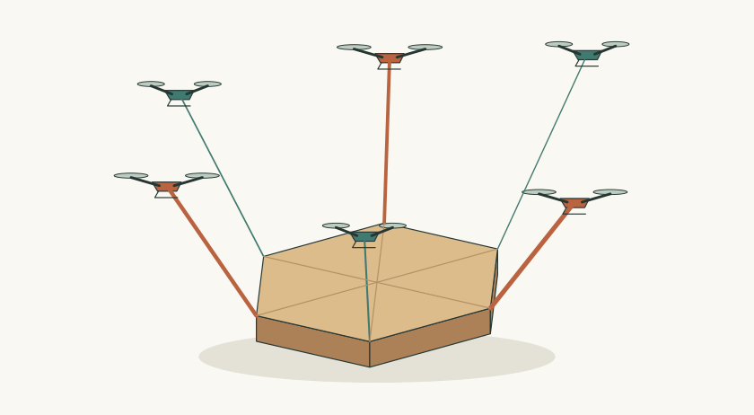
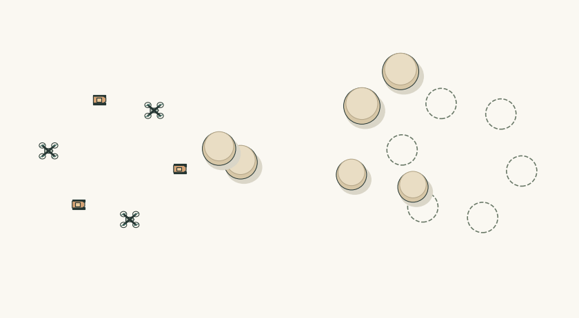
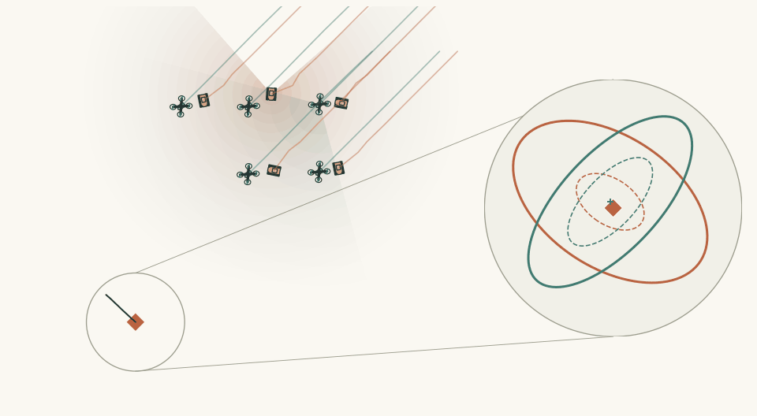

# Interactive conformal prediction for teams of robots

This repository contains the three simulation studies from [“Distributed Interactive Conformal Prediction for Multi-Agent Systems”](https://arxiv.org/abs/2611.29037) by Daniel M. Cherenson and Dimitra Panagou. We use conformal prediction to calibrate a robustness margin for each robot class. The margin sets a threshold for the error measured during a mission. For example, in formation control it specifies how much acceleration prediction error the controller allows for when avoiding obstacles.

After each batch of missions, the robots use a quantile of the observed mission scores to update each class margin. Changing a margin also changes how the robots act or estimate the target, which can affect scores in both classes. The update accounts for this interaction when setting the margins for the next batch.

## Installation

The simulations use Python 3.14 and [uv](https://docs.astral.sh/uv/).

```bash
git clone https://github.com/dcherenson/maicp.git
cd maicp
uv sync
```

## Run the case studies

Run each command from the repository root.

### 1) Cooperative payload force allocation

Three light lift UAVs and three heavy lift UAVs jointly transport a payload. At each sampling time, the robots allocate the required vertical force using their lift capacities, vertical position errors, and class margins. Equation (31) describes the vertical motion of UAV $i$ about its reference position:

$$
\dot e_i=v_i,\qquad
m_i\dot v_i=-k_i^p e_i-k_i^v v_i-(u_i-u_i^0+\epsilon_i).
$$

Here $e_i$ and $v_i$ are the vertical position and velocity errors, $m_i$ is the effective mass, and $k_i^p$ and $k_i^v$ are the position and velocity gains. The allocated force is $u_i$, the nominal load force is $u_i^0$, and the delivered force is $u_i+\epsilon_i$. Each UAV is scored by its largest absolute force residual during the mission. The class score is the largest of its three UAV scores:

$$
S_i=\max_k |\epsilon_{i,k}|,\qquad S_c=\max_{i\,\in\,c} S_i.
$$

We compare calibrated allocation with allocation at zero margins. Each of eight trials includes five margin updates with 500 calibration missions per update.

```bash
uv run python run.py payload
```



### 2) Formation control with obstacle avoidance

Three ground robots and three aerial robots navigate around pillars while tracking a formation. Each robot chooses its commanded acceleration $u_i$ using a learned model. Its class margin accounts for acceleration prediction error in the obstacle constraints. Equation (38) gives the planar dynamics:

$$
\dot p_i=v_i,\qquad
\dot v_i=u_i+
\underbrace{d^{\mathrm{pos}}_{C(i)}(p_i)+d_i^{\mathrm{nbr}}(p)+d_i^{\mathrm{enc}}(p)+w_i}_{d_i}.
$$

The acceleration residual $d_i$ includes the effects of position, neighboring robots, obstacle encounters, and process noise. The controller predicts the position and neighbor terms. If $\hat d_{i,k}$ is its prediction at step $k$, the robot score is the largest acceleration error along its trajectory:

$$
S_i=\max_k\lVert d_{i,k}-\hat d_{i,k}\rVert_2.
$$

Coverage requires at least two of the three ground robots and all three aerial robots to stay within their respective class margins. We also record the fraction of robots that avoid collisions.

```bash
uv run python run.py formation
```



### 3) Distributed target tracking

Five ground robots and five aerial robots track a moving target. The ground robots measure range and bearing with LiDAR. The aerial robots measure bearing with monocular cameras. Each robot combines observations with its neighbors using a distributed rolling window estimator. The estimator predicts the target's planar position and velocity with a constant velocity model at intervals of $\Delta t=0.5$ seconds:

```math
x_k^{\mathrm{tar}}=\begin{bmatrix}p_k^{\mathrm{tar}}
\\
v_k^{\mathrm{tar}}\end{bmatrix},\qquad
x_{k+1}^{\mathrm{tar}}=
\begin{bmatrix}I_2 & \Delta t I_2
\\
0 & I_2\end{bmatrix}
x_k^{\mathrm{tar}}+w_k.
```

Here $w_k$ is process noise. The class margin affects both the weight given to measurements and the size of the reported position ellipse. To score robot $i$, we compare its estimate with the true target position, $e_{i,k}=\hat p_{i,k}-p_k^{\mathrm{tar}}$. The position covariance $P_{i,k}$ sets the scale of the error in each direction. The score is the largest amount by which the resulting Mahalanobis distance exceeds the nominal ellipse radius:

$$
S_i=\max_{k\in T_i^{\mathrm{val}}}
\left[\sqrt{e_{i,k}^{\top}P_{i,k}^{-1}e_{i,k}}-q_{0,C(i)}\right]_+,
\qquad q_{0,c}=\sqrt{\chi^2_{2,1-\alpha_c}}.
$$

Here $T_i^{\mathrm{val}}$ contains the steps at which robot $i$ reports a valid estimate. Its score is zero if the nominal ellipse contains the true target at every such step. Coverage requires at least four of the five robots in each class to enclose the true target position in their reported ellipses at every valid update.

```bash
uv run python run.py tracking
```



For formation and tracking, we run ten margin updates with 300 missions per episode. We use the same missions to compare distributed calibration with five alternatives. These use centralized calibration, omit the correction for changes in the margins, hold the margins fixed, use nominal control or estimation, or calibrate each robot separately.

## Code organization

Each case has its own folder with the simulation and mission animation. Start with [payload](experiments/payload/experiment.py), [formation](experiments/formation/experiment.py), or [tracking](experiments/tracking/experiment.py). The formation and tracking folders each contain a `config.json` and use the [shared calibration algorithm](maicp/algorithm.py). Payload has its own [model settings](experiments/payload/config.py) and [margin update](experiments/payload/calibration.py).

## Outputs

* `results/payload/` contains `summary.json`, scores for each episode, and paired sensitivity checks.
* `results/formation/` and `results/tracking/` contain `metrics.json`, summary figures, and checkpoints for each method.

For payload transport, we derive a bound on how much the force score can change when the margins change. We check the bound by running the same mission twice with different margins. For formation and tracking, the configuration files give the sensitivity coefficients used in the paper. To estimate sensitivity from simulations, we compare scores for the same robot under the same random inputs. We divide the absolute change in score by the normalized distance between the two margin settings and take the largest ratio observed.

Each case writes the paper figures to `figures/` in its output directory. The payload plot shows the change in mission score per unit change in margin, with the analytic bound for each lift class. The formation and tracking plots show both robot classes on one page, as in Figures 6 and 8. New runs save a separate view of their own mission. Formation compares UAV paths near a pillar. Tracking compares the nominal and calibrated ellipses for the same robot at the same times.

To redraw the figures from saved results, add `--plots-only` to the case command. For example:

```bash
uv run python run.py tracking --plots-only
```

Use `--output DIRECTORY` to write a new run to a different directory. To continue an interrupted formation or tracking run, repeat the original command with `--resume`.

## Citation

```bibtex
@article{cherenson2026distributed,
  author  = {Cherenson, Daniel M. and Panagou, Dimitra},
  title   = {{Distributed Interactive Conformal Prediction for Multi-Agent Systems}},
  journal = {arXiv preprint arXiv:2611.29037},
  year    = {2026}
}
```
